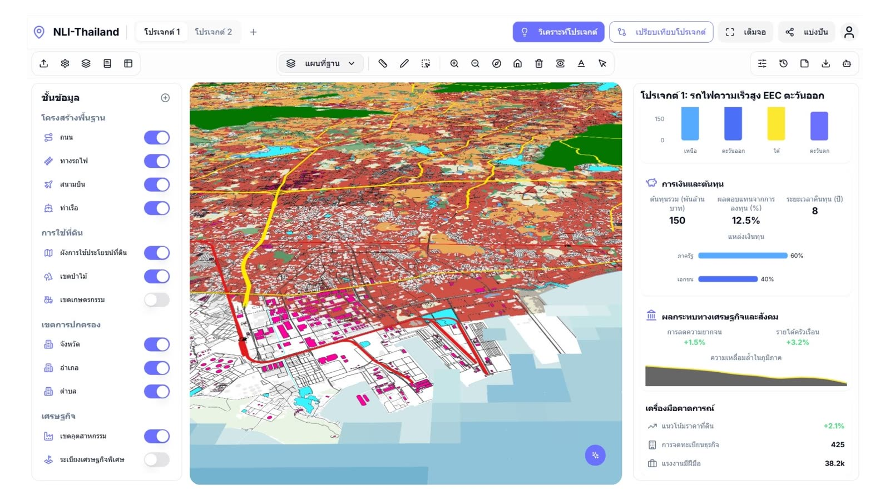
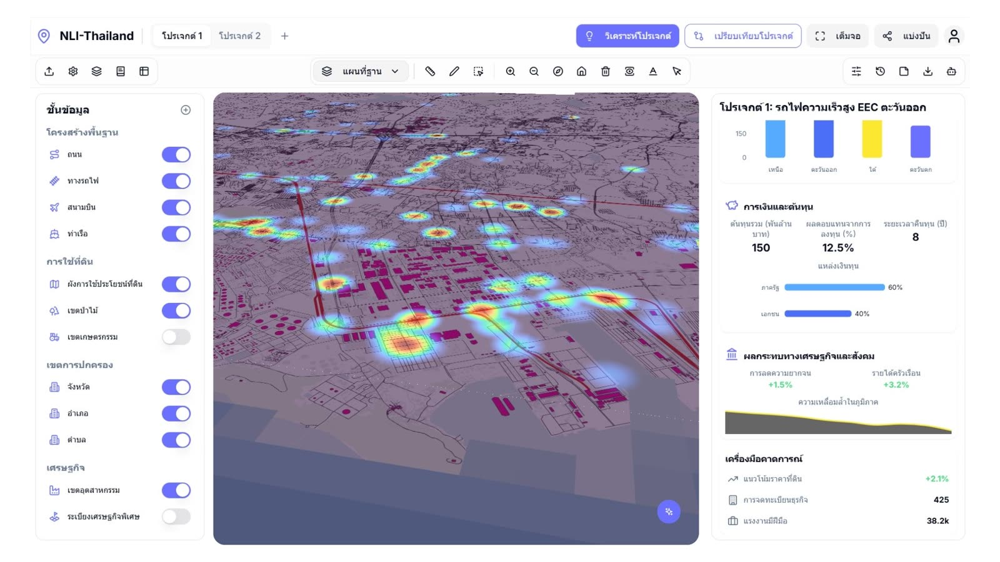
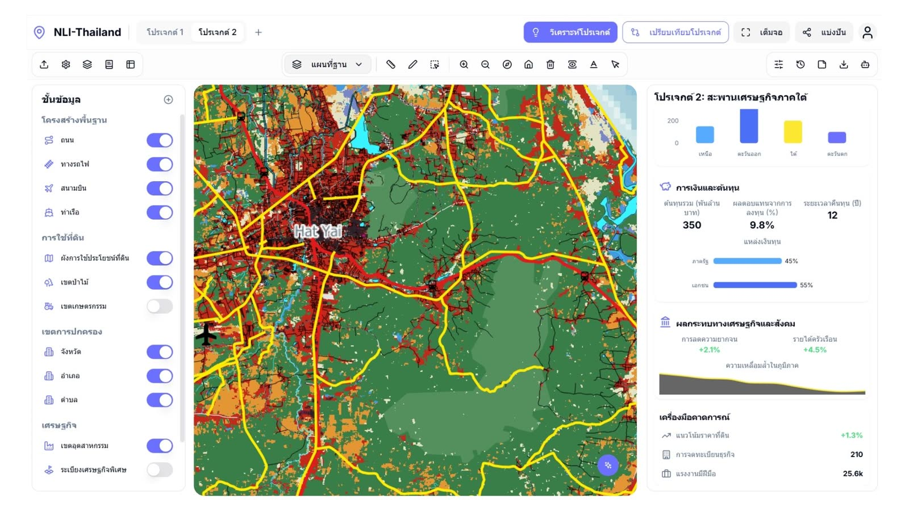
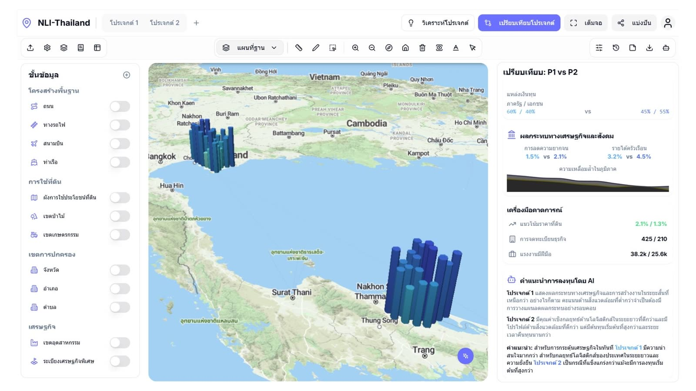

# NLI-Thailand — National Logistic Investment Platform

**Live site: https://mastersungx1.github.io/nli-thailand/**

NLI-Thailand is a GIS decision-support platform for planners and investors assessing large
logistics and infrastructure projects in Thailand, such as high-speed rail, land bridges, ports and
industrial corridors. It combines live government geodata, map tools and a project index
(the NLI index) in one web map.

The project started as a prototype for a 2025 geospatial hackathon and is now a working analysis tool
that runs entirely in the browser.

## What works today

- **41 live data layers** from Thai government open GIS services, loaded straight into the browser:
  - *Transport & logistics*: national highways, rural roads, expressways, railways and stations,
    urban rail (existing and planned), airports, ports and piers by cargo type, inland container
    depots, truck and bus terminals, Ministry of Transport major projects, highway works, Asian Highway
  - *Administrative*: provinces, districts, sub-districts, municipalities
  - *Economy & energy*: gross provincial product per capita, renewable power plants, EGAT power
    plants and dams, petroleum concession blocks
  - *Land use & planning*: land use 2021, EEC land use plan, land reform areas, public land,
    15-minute city score
  - *Forests, water, risk, geology*: reserved forests, national parks, wildlife sanctuaries, river
    basins, irrigation areas, water bodies, streams, groundwater potential, disaster exposure,
    hospitals, rock units by geologic period, geoheritage sites, LiDAR elevation
- Click any feature for its attributes; legends, search and load status in the layer panel
- Very large datasets (for example 4.3 million land-use polygons) load only for the visible area
- **Projects**: draw a corridor, site or point, import one from a file, or pick any feature on the map
- **The NLI index**: a 0-100 score for each project, computed live from the data layers (details below)
- **Finance**: NPV, IRR, benefit-cost ratio and payback from the user's own cost and benefit figures
- **Compare** projects side by side, and **print a report** (save as PDF) with map, indicators and sources
- **Tools**: import GeoJSON / KML / Shapefile, export map image / GeoJSON / CSV, attribute table,
  box selection, layer control, legend, map notes, shareable links, measurement, drawing, 3D tilt
- Free basemaps (street, light, dark, satellite) and a Thai / English interface

## How the NLI index works

Draw a project and the index is calculated from the live data layers across five dimensions:

| Dimension | Indicators |
|---|---|
| Connectivity | Distance to the nearest cargo port, airport, inland container depot, rail station and national highway |
| Economic potential | GPP per capita, population density and industry / transport share of the provinces served |
| Land & planning | Developable share of land use around the project, overlap with land reform areas |
| Environment | Overlap with reserved forests, national parks and wildlife sanctuaries; distance to the nearest one |
| Risk & resources | Disaster exposure of the sub-districts crossed, groundwater potential |

Indicators are normalised to 0-100 and combined with adjustable weights (multi-criteria decision
analysis, with an AHP pairwise-comparison option and its consistency ratio). A sensitivity test
re-runs the index with 1,000 randomised weight sets, so users see how stable a result or a ranking
is. Projects crossing national parks or wildlife sanctuaries are flagged and can be excluded. Every
formula is shown in the app's Method tab.

The index is a screening tool built on open data. Distances are straight-line, not travel time. It
is not a feasibility study or an environmental impact assessment.

**Planned:** an AI assistant that can open layers, run the analysis and explain the results.

| Heatmap analysis | Southern Land Bridge | Compare projects |
|---|---|---|
|  |  |  |

*Screenshots are from the original concept demo.*

## Data sources

Data is fetched live from each agency's public service:
[NGIS Thailand](https://ngis.go.th) and the agencies publishing through it, including the Ministry
of Transport (GI Portal), GISTDA, Land Development Department, Royal Forest Department, Department
of National Parks, Department of Water Resources, Department of Groundwater Resources, Royal
Irrigation Department, DEDE, EGAT, Department of Mineral Fuels, Department of Mineral Resources,
Department of Lands and NESDC. Urban rail and municipal boundaries: Esri Thailand / NOSTRA.
Hospital points are derived from OpenStreetMap.

Basemaps: [OpenFreeMap](https://openfreemap.org), © [OpenMapTiles](https://openmaptiles.org),
© [OpenStreetMap contributors](https://www.openstreetmap.org/copyright); satellite imagery by Esri.

## ภาษาไทย

NLI-Thailand คือแพลตฟอร์มภูมิสารสนเทศช่วยตัดสินใจสำหรับโครงการลงทุนด้านโลจิสติกส์และโครงสร้างพื้นฐานของไทย
เว็บมีชั้นข้อมูลสดจากบริการภาครัฐ 41 ชั้น เครื่องมือแผนที่ที่ใช้งานได้จริง และดัชนี NLI ที่คำนวณจากข้อมูลจริง
ใน 5 มิติ ได้แก่ การเชื่อมต่อ ศักยภาพเศรษฐกิจ ที่ดินและผัง สิ่งแวดล้อม และความเสี่ยงและทรัพยากร
พร้อมตัวชี้วัดทางการเงิน การเปรียบเทียบโครงการ และรายงาน PDF

## Source code

The source code is kept in a private repository. This repository holds the project description and
the published website (the `gh-pages` branch).

© 2025-2026 mastersungx1. All rights reserved. No license is granted to copy, modify or
redistribute the code or content of this project.
